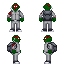

# Зомби Paradise SS220

Перенос с Paradise-SS220, commit [`0fffca1f1f29a63aff49d9b56524813eedf82c6d`](https://github.com/ss220club/Paradise-SS220/tree/0fffca1f1f29a63aff49d9b56524813eedf82c6d). Реализация заменяет прежнее заражение, опухоль и status effect TG; ромерол, бионекропластика, зомби-спавны и массовые админские команды используют одну новую систему.

## Запуск

- `Fun → Zombie Control`: заразить выбранного персонажа, немедленно превратить или вылечить.
- `Mass Zombie Infection` / `Mass Zombie Cure`: заразить или вылечить текущий экипаж.
- Антагонист `Zombie` доступен в стандартной панели антагонистов.
- `Five Plague Talismans` в книге мага стоит одно очко и даёт пояс с пятью одноразовыми талисманами. Каждый поднимает умершего игрока в усиленного слугу с одной случайной болезнью из исходного пула тринадцати.

В исходнике это админское событие. Автоматический выбор первых заражённых и отдельные условия завершения раунда не добавлены. Руинные NPC сохраняют прежний запрет случайного заражения экипажа через поддерживаемый незаразный вариант; администратор может изменить его.

Preview из игрового теста `screenshot_humanoids`, четыре направления:

## Перенесённое поведение

Семь стадий вируса, минутная инкубация и ускорение в мёртвом теле; последовательный некроз конечностей; когти, заражение царапинами, укусы из агрессивного захвата; вскрытие повреждённого черепа и поедание мозга; усиленная регенерация во тьме; многократное оживление после восстановления тела; действие Beta/Gamma/Omega; управление оставленным телом; язык, HUD, plague-когти и прыжок; хирургическое удаление опухоли.

Alpha/Beta/Gamma/Omega сохраняют исходные пулы ингредиентов и прогресс ослабления штамма. Для Gamma нужна заражённая кровь с симптомом разрушения плоти, для Omega — с симптомом регенерации. Sulfonal и сахар размножают имеющееся лекарство. Отсутствовавшие ингредиенты добавлены с рецептами и источниками: рвоту собирают с пола, туалетную воду набирают из унитаза, `????` получают измельчением сгоревшей еды. Вызванное последним пищевое отравление лечится исходными способами: сном, куриным супом и Ginger Ale из Robust Softdrinks.

## Совместимость движков

- Старые `external organs` представлены bodyparts и компонентом некроза; операция с чистым удалением конечности остаётся возможной, травматический отрыв вызывает перелом.
- Абстрактные когти, actions, сигналы и языковые блокировки используют текущие контракты TG; отдельного TG-зомби backend больше нет.
- Формула защиты когтей сохранена отдельно от обычного TG armor penetration, включая полное блокирование удара.
- Исследование использует рандомизированную химию TG, но сохраняет состав и число вариантов исходных рецептов.
- Paradise Lazarus и TG Strange Reagent имели одинаковый рецепт. Существующий typepath Strange Reagent теперь реализует Lazarus; зависящие от него рецепты продолжают использовать тот же тип.
- Lazarus учитывает исходные стадии разложения трупа и риск некроза после оживления. Формальдегид и запрет разложения останавливают рост стадии; уже достигнутая стадия сохраняется.
- Отсутствующий в TG канал клонирования представлен отдельным клеточным повреждением: его не лечит обычное лечение ожогов, травм или токсинов; работают предусмотренные исходником препараты.
- Сторонние расы, общая физиология и существующие препараты общего назначения остаются правилами этого билда. Неорганические тела не становятся обычными заразными зомби.
- Обычная зомби-инфекция сохраняет расу персонажа. Отдельная болезнь Advanced Kingston сохраняет случайную мутацию, используя доступные органические расы PrimeDream; отсутствующие дионы, киданы, драски, греи и скалки не добавлены.

## Авторство ресурсов

Код адаптирован из Paradise SS220 (AGPL/GPL согласно исходному репозиторию). Авторство механик и ресурсов принадлежит участникам Paradise SS220/ParadiseSS13 и исходным авторам.

Оригинальные ресурсы с указанного commit, лицензия CC BY-SA 3.0 согласно README исходника:

- `icons/antaghud.dmi`: состояние `hudzombie` из `icons/mob/hud/antaghud.dmi`.
- `icons/claws_lefthand.dmi`, `claws_righthand.dmi`: состояние `vamp_claws` из `icons/mob/inhands/weapons_lefthand.dmi` и `weapons_righthand.dmi`; кадры и DMI-метаданные сохранены.
- `sound/zomboidalert.ogg`: `sound/ambience/antag/zomboidalert.ogg`.
- `sound/zombie_leap.ogg`: `sound/voice/zombie_leap.ogg`.
- `sound/armblade.ogg`: `sound/weapons/armblade.ogg`.
- `icons/plague_talisman.dmi`: все восемь кадров состояния `plague_talisman` из `icons/obj/wizard.dmi`.
- `sound/mutate.ogg`: `sound/magic/mutate.ogg`.

Иконки предмета и кнопок когтей повторно используют уже перенесённые ресурсы модуля `vampire`; звуки укуса и влажного удара — существующие ресурсы билда.
